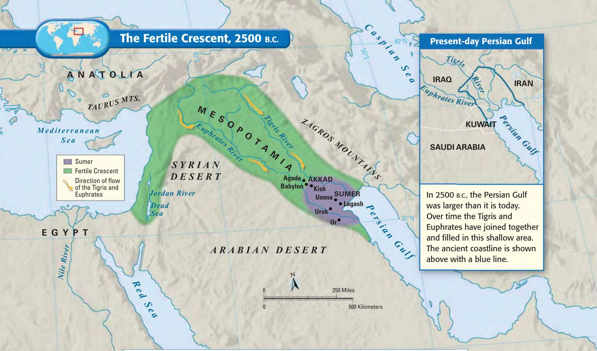
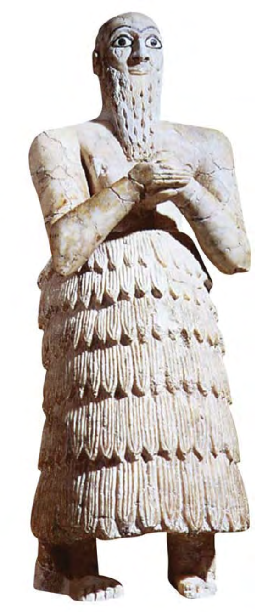
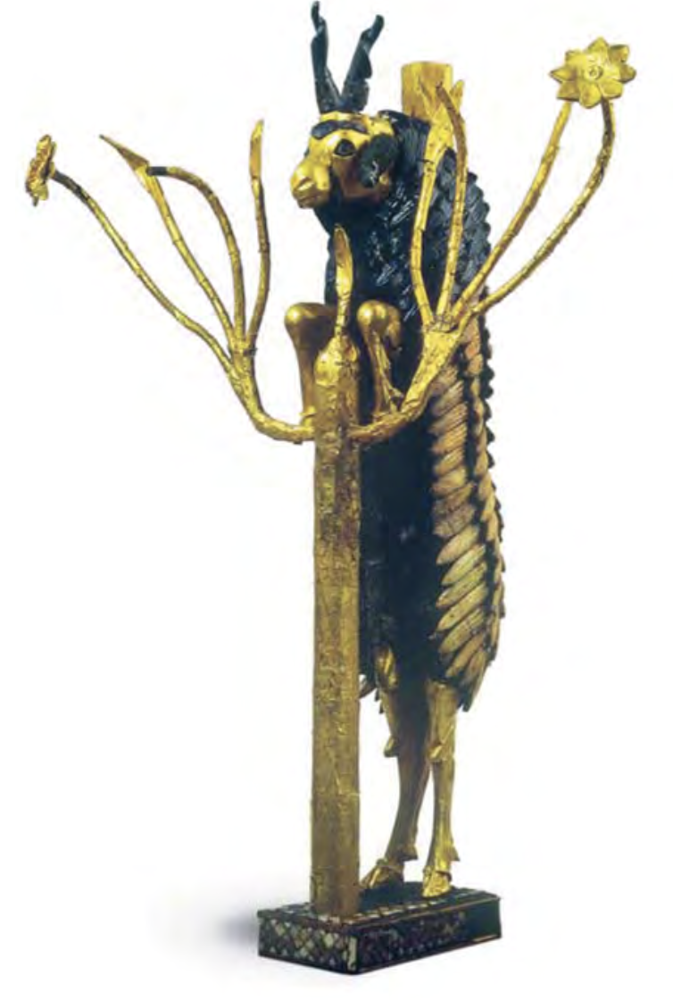
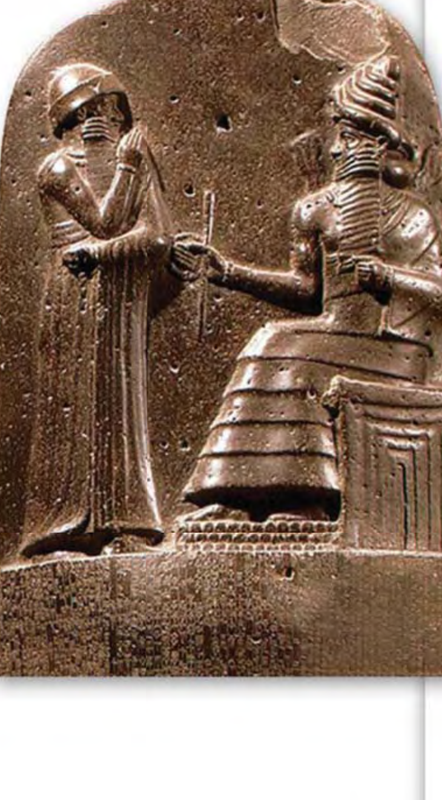

::: {.callout-note title="Welcome to Mesopotamia! · 欢迎来到美索不达米亚！" icon=false}
**Welcome, Grade 6!** Today we are traveling back in time to the very first civilization. Open your booklet, follow the reading with your finger, complete the activities and exit tickets for each period, and finish with the Tourism Poster Challenge! \
*([六年级同学们好！今天我们将穿越时空，探索人类最早的文明。请打开手册，跟随手指朗读，完成每课的活动单与出门票，并最终完成旅游海报大挑战！]{.zh})*
:::

---

## 📚 Bilingual Vocabulary Vault 双语核心词汇库

Before we read, touch and read each word aloud with your class: \
*([阅读前，请用手指轻触并与全班同学一起大声朗读以下核心词汇：]{.zh})*

| English Term | 简体中文 | Student-Friendly Definition (学生释义) | In-Context Example (语境例句) |
| :--- | :--- | :--- | :--- |
| **Mesopotamia** | 美索不达米亚 | The land between two rivers in Southwest Asia.  *[位于西南亚两条大河之间的平原地区]* | 🌊 *Mesopotamia means "land between the rivers."* |
| **Tigris & Euphrates** | 底格里斯河与幼发拉底河 | The two wild rivers that brought water and rich silt.  *[带来水源和肥沃淤泥的两条汹涌河流]* | ⚡ *The Tigris and Euphrates rivers flooded violently.* |
| **Fertile Crescent** | 新月沃地 | A curved, quarter-moon shaped region of rich farm land.  *[呈弯月形、土地极其肥沃的农业发祥地]* | 🌾 *Farmers grew grain across the Fertile Crescent.* |
| **Silt** | 淤泥 | Thick, nutrient-rich soil left behind by floodwaters.  *[洪水退去后沉淀的富含养分的肥沃黑土]* | 🌱 *Annual floods deposited fertile silt on fields.* |
| **City-State** | 城邦 | An independent city and surrounding farms with its own ruler.  *[拥有独立统治者和周围农田的独立城市国家]* | 🏛️ *Ur and Uruk were famous Mesopotamian city-states.* |
| **Polytheism** | 多神信仰 | The belief in many gods who control the forces of nature.  *[相信自然界由众多强大神灵掌控的宗教信仰]* | ⚡ *Sumerians worshipped many gods, like storm god Enlil.* |
| **Ziggurat** | 塔庙 / 神庙塔 | A massive stepped mud-brick pyramid temple in the city center.  *[位于城邦中心的巨型阶梯状泥砖金字塔神庙]* | 🏛️ *Priests climbed the ziggurat to please the gods.* |
| **Cuneiform** | 楔形文字 | The world's first writing system, pressed into wet clay tablets.  *[世界上最早的文字系统，用芦苇笔压印在湿泥板上]* | ✏️ *Scribes pressed reed styluses into soft clay tablets.* |
| **Hammurabi's Code** | 《汉谟拉比法典》 | A set of 282 written laws carved into a tall black stone stele.  *[刻在黑色玄武岩石柱上的282条成文法典]* | ⚖️ *King Hammurabi wrote down 282 laws for fairness.* |



## 🌍 Period 1: Environment & City-States 第1课：环境与城邦

Long ago, people settled in a place called **Mesopotamia** *([美索不达米亚]{.zh})*. In Greek, Mesopotamia means *"the land between the rivers"* *([“两条河流之间的土地”]{.zh})*. 

There are two big rivers here: the **Tigris River** *([底格里斯河]{.zh})* and the **Euphrates River** *([幼发拉底河]{.zh})*. Every year, melting mountain snow caused these rivers to flood violently *([每年高山融雪导致这两条河流暴涨泛滥]{.zh})*. When the floodwaters receded, they left behind thick, fertile mud called **silt** *([肥沃的淤泥]{.zh})*. This mud helped people grow rich crops of wheat and barley in a curved region called the **Fertile Crescent** *([新月沃地]{.zh})*.

{width="60%" fig-alt="Map of Fertile Crescent with Tigris and Euphrates rivers"}

### 🛑 Activity 1.1: Working with Maps 地图定位活动

1. **Map Action (地图行动):**
   - ⭕ **Circle** the **Tigris River** on the map in **blue**; circle the **Euphrates River** in **green**. *([用蓝笔圈出底格里斯河，绿笔圈出幼发拉底河]{.zh})*
   - 👆 **Point** to the curved green **Fertile Crescent** and the **Persian Gulf**. *([指出新月沃地与波斯湾]{.zh})*

2. **Complete the Sentences with Language Frames (利用句型支架完成填空):**
   - **Frame 1 (地理位置):** `Mesopotamia is located between the ____________________ and ____________________ rivers.` \
     *([美索不达米亚位于 ____________________ 河与 ____________________ 河之间。Word Bank: Tigris 底格里斯河 · Euphrates 幼发拉底河]{.zh})*
   - **Frame 2 (河流赠礼):** `Annual floods left behind rich ____________________, which allowed farmers to grow ____________________.` \
     *([每年的洪水留下了肥沃的 ____________________，使农民能够种植丰收的 ____________________。Word Bank: silt 淤泥 · wheat 小麦]{.zh})*



### 🛑 Activity 1.2: Challenges & Solutions 挑战与对策连线

Draw lines to match each Sumerian Challenge to its correct Human Solution: *([连线三大自然挑战与其解决方案：]{.zh})*

| Environmental Challenge (环境挑战) | | Human Solution (人类方案) |
| :--- | :---: | :--- |
| **1. Water (水资源):** Unpredictable floods and droughts *([洪水泛滥与干旱无常])* | | **A. Mud-brick walls (泥砖城墙):** Sun-dried bricks into thick defensive city walls *([筑造厚实坚固城墙])* |
| **2. Defence (防卫安全):** Flat plains with no natural barriers *([平原坦荡无天然屏障])* | | **B. Barter trade (物物交换贸易):** Exchanged surplus grain and cloth for wood and metal *([换取木材与金属])* |
| **3. Resources (资源匮乏):** Scarcity of stone, timber and metal *([缺乏石料、木材与金属])* | | **C. Irrigation canals (开挖灌溉水渠):** Dug channels and basins to store and direct floodwater *([蓄水引流灌溉农田])* |

**Cause & Effect Language Frames (因果表达句型):** \
• `Because Mesopotamia lacked natural barriers, Sumerians built ________________________________________ to protect themselves.` \
  *([因为缺乏天然屏障，苏美尔人建造了 ________________________________________ 来保护自己。]{.zh})* \
• `Because river floods were unpredictable, farmers dug ________________________________________ to water their crops.` \
  *([因为河流泛滥无常，农民们开挖了 ________________________________________ 来浇灌庄稼。]{.zh})*

### 📝 Exit Ticket ET-1 当堂检测 1 (不看笔记作答)

1. What does **"Mesopotamia"** mean in Greek? *([“美索不达米亚”在希腊语中是什么意思？]{.zh})* \
   *Sentence Frame:* In Greek, Mesopotamia means *"the land between the ____________________"*. *([意为“位于 ________ 之间的土地”。]{.zh})*
2. Name the **two lifeline rivers**: *([写出两条生命之河的名称：]{.zh})* \
   *Sentence Frame:* The two lifeline rivers are the ____________________ and the ____________________. *([两条生命之河是 ________ 河与 ________ 河。]{.zh})*
3. State **one environmental challenge** and how people solved it: *([写出一个环境挑战及古人的解决方案：]{.zh})* \
   *Challenge Frame:* The Sumerians faced ________________________________________. *([面临的挑战：________________________________________]{.zh})* \
   *Solution Frame:* They solved this by building ________________________________________. *([解决方案：________________________________________]{.zh})*



## 🏛️ Period 2: Sumerian Culture & Beliefs 第2课：信仰、文化与社会阶层

Because people worked together to build irrigation canals, they produced a **food surplus** *([粮食剩余]{.zh})*. With plentiful food, populations grew, and people lived together in large, independent **city-states** *([城邦]{.zh})* like **Ur** and **Uruk**. 

In the center of every city stood a towering, stepped mud-brick temple called a **ziggurat** *([塔庙 / 神庙塔]{.zh})*. Sumerians practiced **polytheism** *([多神信仰]{.zh})*, believing that many powerful gods controlled the forces of nature. Because river floods were sudden and destructive, they feared the anger of **Enlil**, the god of storms *([风暴之神恩利尔]{.zh})*.

### 🛑 Activity 2.1: The 3-Tier Social Hierarchy 社会三大阶层

Fill in the three tiers of the Mesopotamian social hierarchy using the Word Bank: *([使用词库填入社会三大阶层并体会分工：]{.zh})* \
*(Word Bank: **Enslaved People (奴隶)** · **Kings & Priests (国王与祭司)** · **Farmers, Artisans & Traders (农民、工匠与商人)**)*

1. **Top Tier (顶层):** __________________________________________________ \
   *Sentence Frame:* Kings and priests ruled the cities and spoke to the ____________________. *([国王与祭司统治城邦并向 ________ 祈求保佑。]{.zh})*
2. **Middle Tier (中层):** __________________________________________________ \
   *Sentence Frame:* Farmers and artisans grew ____________________ and crafted tools for trade. *([农民与工匠种植 ________ 并制作工具用于贸易。]{.zh})*
3. **Bottom Tier (底层):** __________________________________________________ \
   *Sentence Frame:* Enslaved people had no freedom and performed unpaid ____________________ labor. *([奴隶没有自由，从事无偿 ________ 劳动。]{.zh})*



### 🛑 Activity 2.2: 3-Step Artifact Investigation 史料研读三步法

Examine the two primary artifacts from ancient Sumer side-by-side: *([仔细对比观察下方两件古苏美尔原始文物，完成三步史料探究分析：]{.zh})*

| Source A: Votive Statue (阿斯马尔还愿雕像) | Source B: Golden Ram of Ur (乌尔皇陵金羊神兽) |
| :---: | :---: |
| {height="75pt"} | {height="75pt"} |
| **Step 1: Observe (第一步：仔细观察)**   Hands are folded in ____________________ *(prayer)* and eyes are wide ____________________ .   *([雕像双手合十祈祷，双眼睁大。]{.zh})* | **Step 1: Observe (第一步：仔细观察)**   Crafted from precious ____________________ and blue ____________________ *(gold / lapis)*.   *([器物由珍贵黄金和深蓝色青金石精雕而成。]{.zh})* |
| **Step 2: Infer (第二步：合理推断)**   Placed in ziggurat to continuously ____________________ to the gods in their place.   *([供奉于塔庙，代表自己时刻向神明祈祷。]{.zh})* | **Step 2: Infer (第二步：合理推断)**   Buried in a royal tomb shows that rulers possessed great ____________________ .   *([奢华随葬品表明苏美尔统治者拥有巨大权力。]{.zh})* |
| **Step 3: Evidence (第三步：实证推论)**   Proves that Sumerians practiced ____________________ *(polytheism)* and feared gods.   *([实证苏美尔人信奉多神信仰，敬畏神明。]{.zh})* | **Step 3: Evidence (第三步：实证推论)**   Fine carving proves Sumer had skilled ____________________ and distinct social classes.   *([精湛工艺实证苏美尔拥有工匠与阶层分化。]{.zh})* |

### 📝 Exit Ticket ET-2 当堂检测 2 (不看笔记作答)

1. What is **polytheism**? *([什么是多神信仰？]{.zh})* \
   *Sentence Frame:* Polytheism is the belief in ____________________ gods. *([相信并崇拜 ________ 位神灵。]{.zh})*
2. What was the purpose of building a **ziggurat**? *([修建塔庙神殿的主要目的？]{.zh})* \
   *Sentence Frame:* Built as a temple to ____________________ the gods. *([作为神殿来 ________ 神明。]{.zh})*
3. List the **three social classes** from top to bottom: *([按自上而下的顺序列出三大阶层：]{.zh})* \
   (1) ________________________ $\rightarrow$ (2) ________________________ $\rightarrow$ (3) ________________________ \
   *(Word Bank: Kings & Priests 国王祭司 · Farmers & Artisans 平民工匠 · Enslaved People 奴隶)*



## ⚖️ Period 3: Empires & Hammurabi’s Code 第3课：帝国兴起与汉谟拉比法典

Over time, independent city-states were united into great empires. King **Sargon of Akkad** *([阿卡德萨尔贡大帝]{.zh})* built the world's first empire around 2330 B.C. Later, around 1792 B.C., King **Hammurabi of Babylon** *([巴比伦国王汉谟拉比]{.zh})* conquered all of Mesopotamia.

To keep order among different peoples, Hammurabi carved **282 laws** onto a giant black basalt stone pillar called a **stele** *([黑色玄武岩石柱]{.zh})*. At the top, a carving showed Shamash, the Sun God of Justice, handing the laws and scepter to King Hammurabi (**Divine Kingship** / 君权神授).

{width="20%" fig-alt="The Stele of King Hammurabi"}

### 🛑 Activity 3.1: Examining the Laws 对比三条法条

Read these three laws from the Code of Hammurabi carefully: *([仔细研读以下三条法典法条：]{.zh})*

- **Law §8 (第8条 - 盗窃惩处):** *If anyone steals cattle or sheep from the temple or palace, he shall pay thirtyfold (30×); if from a free citizen, tenfold (10×). If the thief cannot pay, he shall be put to death.* *([盗窃神庙王宫牛羊偿还30倍；盗窃自由民偿还10倍；无力偿还处死刑。]{.zh})*
- **Law §196 (第196条 - 自由民同等报应):** *If a man put out the eye of another free man, his eye shall be put out.* *([自由民损毁另一自由民之眼，则应损毁其眼——“以眼还眼”。]{.zh})*
- **Law §199 (第199条 - 奴隶受害赔偿金钱):** *If he put out the eye of a man's slave, he shall pay one-half of the slave's purchase value in silver.* *([损毁奴隶之眼，仅须赔偿该奴隶身价之一半银两。]{.zh})*

**Quick Check (快速判断与分析):** \
Did Law §196 apply equally if someone injured an enslaved person? *([如果伤害了奴隶，第196条是否同等适用？]{.zh})* \
Circle: &nbsp;&nbsp;&nbsp;&nbsp; **YES (是)** &nbsp;&nbsp;&nbsp;&nbsp; / &nbsp;&nbsp;&nbsp;&nbsp; **NO (否)** \
*Bilingual Language Frame (解释句型支架):* \
`Law §196 did [ NOT ] apply equally to slaves because slaves were treated as ____________________ (property / equal citizens), so the offender only paid a fine.` \
*([解释句型：第196条并未同等适用于奴隶，因为奴隶被视为 ____________________（财产/平等的公民），伤害奴隶只需赔偿罚金。]{.zh})*



### 🛑 Activity 3.2: 5-Sentence Argument Paragraph 观点论证五步法写作

**Prompt (论证任务):** *"Was the Code of Hammurabi a fair system of justice?"* *([《汉谟拉比法典》是一套公平的正义体系吗？]{.zh})* \
Complete the 5-sentence argument paragraph using the sentence starters: *([运用句型支架完成五句话论证段落：]{.zh})*

1. **Sentence 1 · Claim (提出主张):** `In my opinion, the Code of Hammurabi was ____________________ (fair / unfair).` \
   *([依我看来，《汉谟拉比法典》是 ____________________（公平的 / 不公平的）。]{.zh})*
2. **Sentence 2 · Reason (阐明理由):** `It was ____________________ because people of different classes were treated ____________________ (equally / unequally).` \
   *([它是如此，因为在古巴比伦，不同阶层的人所受到的法律对待是 ____________________（平等的 / 不平等的）。]{.zh})*
3. **Sentence 3 · Evidence 1 (证据一：自由民对待):** `For example, Law §196 shows that when a free citizen harms another free citizen, the punishment is ________________________________________ ("an eye for an eye").` \
   *([例如，第196条表明，当自由民伤害另一自由民时，惩罚是 ________________________________________（以眼还眼）。]{.zh})*
4. **Sentence 4 · Evidence 2 (证据二：奴隶对待):** `However, Law §199 shows that when someone harms an enslaved person, they only have to ________________________________________ (pay silver).` \
   *([然而，第199条表明，当有人伤害奴隶时，他们只需要 ________________________________________（赔付银两）。]{.zh})*
5. **Sentence 5 · Conclusion (总结升华):** `Therefore, this proves that Hammurabi's Code protected the interests of ________________________________________ (wealthy property owners / all citizens equally).` \
   *([因此，这证明法典核心保护了 ________________________________________（有产阶级与统治者 / 所有人的平等权利）。]{.zh})*

### 📝 Exit Ticket ET-3 当堂检测 3 (不看笔记作答)

1. Who was **Hammurabi**? *([汉谟拉比是谁？]{.zh})* \
   *Sentence Frame:* Hammurabi was the King of ____________________ who created a written ____________________. *([汉谟拉比是 ________ 国王，制定了成文 ________。]{.zh})*
2. What famous phrase summarizes **Law §196**? *([哪句名言概括了第196条的精神？]{.zh})* \
   *"An eye for an ____________________, a tooth for a ____________________."* *([“以 ________ 还 ________，以 ________ 还 ________。”]{.zh})*
3. Was the Code equal for enslaved people? Write YES or NO and explain: *([法典对奴隶平等吗？写出YES或NO并简述理由：]{.zh})* \
   *Sentence Frame:* The Code was [ NOT ] equal for slaves because ________________________________________. *([法典对奴隶不平等，因为 ________________________________________。]{.zh})*



## 🎨 Part 4: Tourism Poster Challenge 旅游海报大挑战

Imagine you are a travel agent in ancient Mesopotamia! You want travelers from all over the ancient world to visit your city-state. *([想象你是古代旅游推广官，吸引世界旅行者造访你的城邦。]{.zh})*

::: {.callout-important title="🎯 Poster Requirements (海报评分三大要素)" icon=false}
Your tourism poster **MUST INCLUDE (必须包含以下要素)**:
1. 🗺️ **1 Geographic Fact (地理事实):** Name the Tigris or Euphrates River, fertile silt, or the Fertile Crescent. *([提及底格里斯河或幼发拉底河、肥沃淤泥或新月沃地]{.zh})*
2. 💡 **1 Smart Invention (古代发明):** Include the wooden wheel, cuneiform writing, irrigation canals, or the ziggurat. *([画出木制车轮、泥板楔形文字、灌溉水渠或塔庙神殿]{.zh})*
3. ✍️ **Required Language Frames (宣传推介句):** Fill in the bilingual sentence starters clearly at the bottom! *([在底部工整填写双语句型支架！]{.zh})*
:::

### 🖼️ Your Poster Workspace 海报创作区

::: {.card style="border: 2.5px dashed #003477; border-radius: 12px; background: #fffdfa; padding: 14px; margin: 10px 0;"}

::: {style="text-align: center; border-bottom: 2px solid #e2e8f0; padding-bottom: 8px; margin-bottom: 10px;"}
[**VISIT MESOPOTAMIA! · 畅游美索不达米亚！**]{style="color: #003477; font-size: 1.25em;"} \
*(Draw your city-state, rivers, ziggurat, and inventions in the box below · 请在下方画出你的城邦、河流、神庙与发明)*
:::

::: {.poster-drawing-box style="height: 220px; border: 1px dotted #cbd5e1; border-radius: 8px; margin: 10px 0; background: #ffffff;"}
:::

::: {style="border-top: 2px dashed #003477; padding-top: 10px; margin-top: 10px;"}
**✍️ Write Your Promotion Sentences Here (必须填写的推介句型):**

1. **Geographic Appeal (地理吸引力):** \
   [**The** __________________________ **River is a wonderful reason to visit** __________________________]{style="color: #003477;"} \
   [**because** __________________________________________________________________________________ .]{style="color: #003477;"} \
   *([ ____________________ 河是造访 ____________________ 的绝佳理由，因为其肥沃的淤泥能生长出丰收的麦粮！]{.zh})* \
   *(River options: Tigris / Euphrates · City options: Ur / Babylon / Uruk)*

2. **Invention Appeal (发明与文化吸引力):** \
   [**In our city-state, you can travel with the wooden** __________________________ **and admire our grand** __________________________ !]{style="color: #003477;"} \
   *([在我们城邦，你可以体验实木 ____________________（车轮），并瞻仰宏伟的 ____________________（塔庙）！]{.zh})* \
   *(Invention options: wheel 车轮 · cuneiform script 楔形文字 · ziggurat temple 塔庙神殿)*
:::

:::



## 👩‍🏫 Assessment & Rubric 评价与评估标准

::: {.teacher-only}
### MYP Year 1 Assessment Rubric (Criteria A & D)

| Criterion | Level 1–2 (Emerging 起步) | Level 3–4 (Competent 达标) | Level 5–6 (Substantial 熟练优秀) |
| :--- | :--- | :--- | :--- |
| **Criterion A:** Knowing & Understanding (Vocab & Geography) | Identifies fewer than 2 geographic facts or terms correctly.  *[能正确识别少于2个核心地理事实或词汇]* | Correctly locates Tigris/Euphrates and identifies at least 1 invention.  *[能准确定位两条大河并指出至少1项发明]* | Accurately identifies both rivers, fertile silt, and explains the purpose of the wheel, cuneiform, and laws.  *[精准阐述两河、淤泥以及车轮、文字与法典的历史作用]* |
| **Criterion D:** Thinking Critically (Sentence Starter & Justification) | Sentence starter is incomplete or provides no reason.  *[推介句未写完整或未给出合理解释]* | Completes sentence starter with an adequate reason connected to water or farming.  *[能运用句型给出与水源或农耕相关的合理理由]* | Completes sentence starter with a compelling, detailed reason linking geographic gifts to human invention.  *[论证详实精当，深刻揭示自然地理与人类文明发明的内在联系]* |
:::
