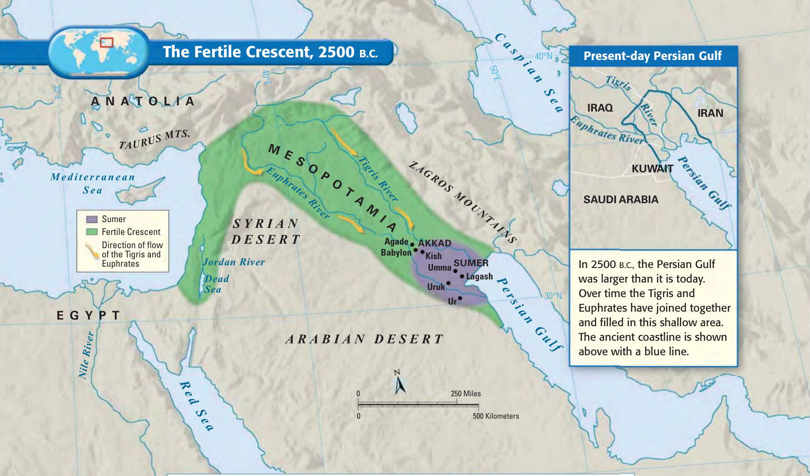
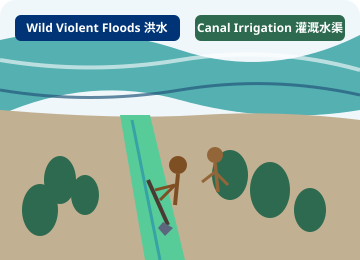
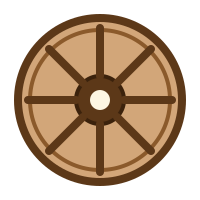
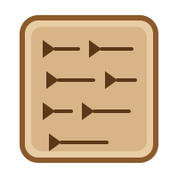
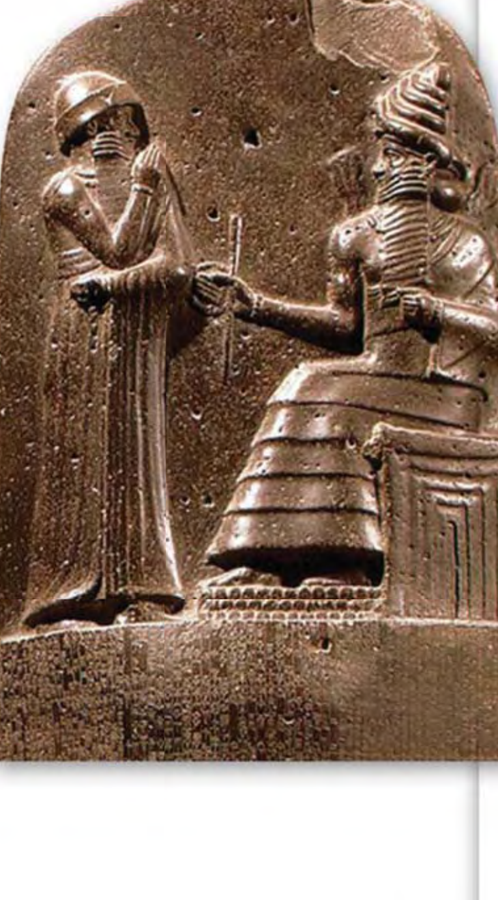

## Welcome to Mesopotamia! 欢迎来到美索不达米亚！

::: {.columns}
::: {.column width="48%"}
{fig-alt="Map of the Fertile Crescent with Tigris and Euphrates rivers" style="border-radius: 10px; border: 2px solid #003477; box-shadow: 0 4px 12px rgba(0,0,0,0.12);"}
:::

::: {.column width="52%"}
### Welcome to the "Land Between the Rivers"!

::: {.callout-note icon=false title="📖 Student Direction"}
**Open your Reading Booklet to Part 1.**
:::

::: {.card style="background: #ebf7fd; border-left: 5px solid #0087ff; padding: 10px 14px; margin-bottom: 12px;"}
**Bilingual Vocabulary Anchor / 核心词汇:** \
[**Mesopotamia**]{style="font-size: 1.25em; color: #003477; font-weight: 700;"} · [美索不达米亚]{.zh style="font-size: 1.15em; color: #005691; font-weight: 600;"}
:::

::: {.callout-tip icon=false title="👆 Student Action"}
**Point to Mesopotamia on the map in your booklet.**
:::


:::
:::

<!-- Chalkline Overlay Zone: White space at the bottom for live pen and annotation tools -->

  🖊️ <strong>Chalkline Overlay Space</strong> · Use pen or spotlight tool to highlight Tigris & Euphrates rivers on the map

::: notes
**Target Time:** 3 mins

**Teacher script:** "Welcome, Grade 6! Today we are traveling back in time to the very first civilization. Everyone, touch the word 'Mesopotamia' in your booklet. It is a big word, but it just means 'land between the rivers'."

**Multilingual Check:** Choral response: "Let's say it together: Me-so-po-ta-mi-a."
:::

---

## The Wild Rivers 汹涌的河流

::: {.columns}
::: {.column width="48%"}
{fig-alt="Flooding rivers and canal irrigation illustration" style="border-radius: 10px; border: 2px solid #003477; box-shadow: 0 4px 12px rgba(0,0,0,0.12);"}

::: {.card style="background: #fdf6ec; border-left: 5px solid #ff8c0f; padding: 10px 14px; margin-top: 12px;"}
- The **Tigris** and **Euphrates** rivers flooded violently. \
  *([底格里斯河和幼发拉底河经常发生凶猛的洪水。]{.zh})*
- People worked together to **dig canals**. \
  *([人们齐心协力开挖水渠。]{.zh})*
:::

::: {.card style="background: #ebf7fd; border-left: 5px solid #0087ff; padding: 8px 14px; margin-top: 10px;"}
**Bilingual Vocabulary Anchor / 核心词汇:** \
[**Tigris & Euphrates**]{style="font-size: 1.1em; color: #003477; font-weight: 700;"} · [底格里斯河与幼发拉底河]{.zh style="font-size: 1.05em; color: #005691; font-weight: 600;"}
:::

::: {.callout-important icon=false title="🛑 Student Action"}
**🛑 Stop & Check 1: Circle the two rivers in your packet!**
:::


:::

::: {.column width="52%"}
<!-- Chalkline Overlay Zone: Left blank intentionally for Stop & Check 1 Circle Activity overlay -->

  

    

      📋 Chalkline Overlay: Stop & Check 1
      Live Projection Zone
    

    

      
<strong>Look at your Reading Booklet map:</strong>

      

        ⭕ <strong>Circle</strong> the Tigris River in your packet.  
        ⭕ <strong>Circle</strong> the Euphrates River in your packet.
      

    

  

  

    Teacher: Project your student packet here or use pen tool to demonstrate circling on the board
  

:::
:::

::: notes
**Target Time:** 7 mins

**Teacher script:** "These rivers were not peaceful. They were wild and violent! To survive, people had to work as a team. Let's look at our Stop & Check on the board." (Overlay packet here).

**Multilingual Check:** "Who can translate 'violent floods' into Chinese for us? Yes, 凶猛的洪水!"
:::

---

## Smart Inventions 聪明的发明

::: {.columns}
::: {.column width="30%"}
::: {.card style="text-align: center; padding: 18px 12px; background: #ffffff; border: 2px solid #c9b48f; border-radius: 12px; box-shadow: 0 4px 12px rgba(0,0,0,0.06); height: 440px; display: flex; flex-direction: column; justify-content: space-between;"}

  <h4 style="color: #5c3818; margin-top: 0; font-size: 1.1em;">The Wooden Wheel</h4>
  
木制车轮

  {fig-alt="Wooden wheel icon" style="width: 150px; margin: 0 auto;"}

  Invented for transport carts to move heavy crops!

:::
:::

::: {.column width="30%"}
::: {.card style="text-align: center; padding: 18px 12px; background: #ffffff; border: 2px solid #c9b48f; border-radius: 12px; box-shadow: 0 4px 12px rgba(0,0,0,0.06); height: 440px; display: flex; flex-direction: column; justify-content: space-between;"}

  <h4 style="color: #5c3818; margin-top: 0; font-size: 1.1em;">Cuneiform on Clay</h4>
  
泥板上的楔形文字

  {fig-alt="Clay tablet with cuneiform" style="width: 150px; margin: 0 auto;"}

  First written symbols pressed with reeds into wet clay!

:::
:::

::: {.column width="40%"}
::: {.card style="background: #ffffff; border: 2px solid #003477; border-radius: 12px; padding: 18px; box-shadow: 0 4px 14px rgba(0,0,0,0.08); min-height: 440px;"}
<h4 style="color: #003477; margin-top: 0;">Key Achievements:</h4>

- **Because of teamwork**, they built the first cities. \
  *([因为团结合作，他们建立了最早的城市。]{.zh})*
- They **invented the wheel** for carts. \
  *([他们为马车发明了车轮。]{.zh})*
- They invented the **first writing on clay**. \
  *([他们发明了泥板上的最早文字。]{.zh})*

::: {.card style="background: #ebf7fd; border-left: 4px solid #0087ff; padding: 6px 10px; margin: 8px 0;"}
**Bilingual Anchor / 核心词汇:** [Cuneiform]{style="color: #003477; font-weight: 700;"} · [楔形文字]{.zh style="color: #005691; font-weight: 600;"}
:::

::: {.callout-tip icon=false title="✋ Student Action"}
**Trace a cuneiform shape in the air with your finger!**
:::


:::
:::
:::

::: notes
**Target Time:** 5 mins

**Teacher script:** "When people work together, their brains create amazing things. They invented the wheel to move food, and cuneiform to keep records. Imagine writing your homework on heavy wet clay!"

**Multilingual Check:** Pair-share: "Tell your partner one invention from this slide in English."
:::

---

## The First Written Laws 世界上第一部成文法律

::: {.columns}
::: {.column width="48%"}
{fig-alt="Black stone pillar stele of Hammurabi" style="max-height: 250px; display: block; margin: 0 auto; border-radius: 8px;"}

::: {.card style="background: #fdf6ec; border-left: 5px solid #ff8c0f; padding: 10px 14px; margin-top: 10px;"}
- **King Hammurabi** wrote down the first laws. \
  *([汉谟拉比国王写下了世界上最早的法律。]{.zh})*
- Famous rule: **"An eye for an eye."** \
  *([著名原则：“以眼还眼”。]{.zh})*
:::

::: {.card style="background: #ebf7fd; border-left: 5px solid #0087ff; padding: 8px 14px; margin-top: 8px;"}
**Bilingual Vocabulary Anchor / 核心词汇:** \
[**Hammurabi's Code**]{style="font-size: 1.1em; color: #003477; font-weight: 700;"} · [《汉谟拉比法典》]{.zh style="font-size: 1.05em; color: #005691; font-weight: 600;"}
:::

::: {.callout-important icon=false title="🛑 Student Action"}
**🛑 Stop & Check 1: Fill in the blank for the first written laws!**
:::


:::

::: {.column width="52%"}
<!-- Chalkline Overlay Zone: Blank space for the Chalkline overlay of the "Fill in the blank" question -->

  

    

      📋 Chalkline Overlay: Fill in the Blank
      Live Class Check
    

    

      
<strong>Fill in the missing words from your packet:</strong>

      
      

        

          1. King ________________________ carved 282 laws into a black stone pillar. \
          *([________________________ 国王将 282 条法律刻在黑石柱上。]{.zh})*
        

        

          2. His most famous law is: <em>"An ______________ for an ______________."</em> \
          *([他最著名的法律是：“以______________还______________。”]{.zh})*
        

      

      

        💡 <strong>Word Bank:</strong> Hammurabi · eye · eye · Babylon
      

    

  

  

    Teacher: Overlay student booklet and demonstrate filling in the blanks
  

:::
:::

::: notes
**Target Time:** 10 mins

**Teacher script:** "With cities getting bigger, they needed rules. King Hammurabi carved his laws into a giant stone so everyone could see them. Look at your packet and let's fill in the blank together on the board."

**Multilingual Check:** EAL prompt: Provide the spelling of Hammurabi clearly on the board for students to copy accurately into their blanks.
:::

---

## Tourism Poster Challenge 旅游海报挑战

::: {.columns}
::: {.column width="45%"}
{fig-alt="Mesopotamia Tourism Poster Example" style="border-radius: 12px; border: 2px solid #003477; box-shadow: 0 6px 18px rgba(0,0,0,0.15); width: 95%;"}
:::

::: {.column width="55%"}
### Your Task: Create a tourism poster for Mesopotamia!

::: {.callout-note icon=false title="🎯 Poster Requirements · 海报要求"}
Your poster **MUST INCLUDE**:
1. 🗺️ **1 geographic fact** *(e.g., Tigris River, Euphrates River, fertile silt)*
2. 💡 **1 invention** *(e.g., wheel, cuneiform writing, irrigation canals, ziggurat)*
:::

::: {.card style="background: #ebf7fd; border-left: 5px solid #0087ff; padding: 10px 14px; margin-bottom: 14px;"}
**Bilingual Vocabulary Anchor / 核心词汇:** \
[**City-State**]{style="font-size: 1.15em; color: #003477; font-weight: 700;"} · [城邦 (如乌尔、巴比伦)]{.zh style="font-size: 1.05em; color: #005691; font-weight: 600;"}
:::

::: {.callout-tip icon=false title="✍️ Sentence Starter · 核心句型 (Must Write in Poster)"}
[**"The ________ river is a great reason to visit ________ because ________________________________________ ."**]{style="font-size: 1.05em; color: #003477; font-weight: 700;"}
:::


:::
:::

::: notes
**Target Time:** 20 mins

**Teacher script:** "Now it is your turn to be a travel agent. You want tourists to visit your Mesopotamian city-state! Draw a beautiful poster, and use our sentence starter to convince them to come."

**Multilingual Check:** Allow emerging bilinguals to draft their "because..." reasoning in Chinese first, then work with a partner or teacher to translate it into simple English.
:::
