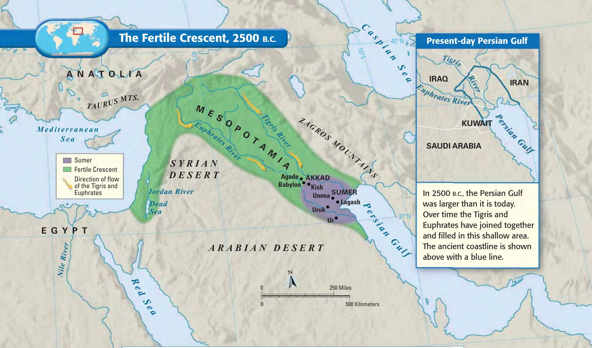
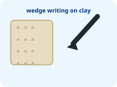
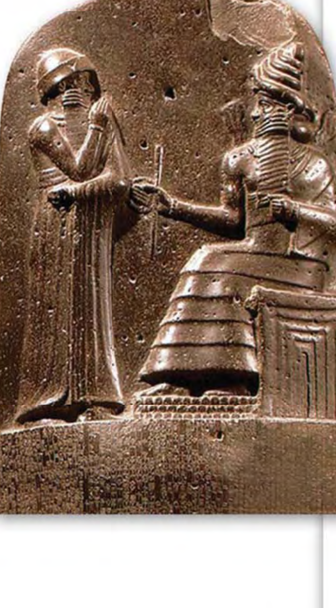

```{python}
import sys; sys.path.append("scripts")
from vocab import load_unit, pick, word_bank
terms = load_unit(1)
```

::: {.callout-note title="Welcome to Ancient Civilizations! · 欢迎学习古代文明！" icon=false}
In this chapter, we will explore the world's first cities. We will use our eyes to observe maps, our minds to think about rules, and our words to share ideas with classmates! \
*([在这一章中，我们将探索世界上最早的城市。我们将用眼睛观察地图，用大脑思考规则，用语言与同学们分享观点！]{.zh})*
:::

---

## 🌍 Section 1: The Land Between Two Rivers 第1节：两河之间的土地

::: {.callout-tip title="Section 1 Vocabulary Bank · 核心词汇库" icon=false}
- **** *(美索不达米亚)*: The land between two rivers.
- **** *(新月沃地)*: Green, fertile land in Southwest Asia that is good for growing crops.
- **Tigris & Euphrates Rivers** *(底格里斯河与幼发拉底河)*: The two great rivers flowing into the Persian Gulf.
- **** *(淤泥)*: Rich, fine soil left on fields after river floods.
:::

Long ago, people moved to a place called **Mesopotamia** *([美索不达米亚]{.zh})*. In Greek, Mesopotamia means *"the land between the rivers."* \
*([很久以前，人们搬到了一个叫美索不达米亚的地方。在希腊语中，美索不达米亚的意思是“两河之间的土地”。]{.zh})*

There are two big rivers here: the **Tigris River** *([底格里斯河]{.zh})* and the **Euphrates River** *([幼发拉底河]{.zh})*. The rivers gave people fresh water to drink and water for their crops. Every year, floodwaters brought rich soil called **silt**. This green area is called the **Fertile Crescent** *([新月沃地]{.zh})*. \
*([这里有两条大河：底格里斯河与幼发拉底河。河流为人们提供饮用水和农田灌溉用水。每年洪水带来被称为淤泥的肥沃泥土。这片绿色的区域被称为新月沃地。]{.zh})*

{width="85%" fig-alt="Map showing Mesopotamia, Tigris and Euphrates rivers, and Fertile Crescent"}

### ✏️ Activity 1.1: Observing the Map 观察地图

Look at the map above carefully. Complete the three sentences: \
*([仔细观察上方的地图，完成以下三个填空：]{.zh})*

1. **Mesopotamia** means the land between two ____________________. \
   *([美索不达米亚的意思是两条____________________之间的土地。]{.zh})*

2. The names of the two great rivers are the ____________________ River and the ____________________ River. \
   *([这两条大河的名字分别是____________________河与____________________河。]{.zh})*

3. The green land shaped like a quarter-moon that is very good for farming is called the ____________________ Crescent. \
   *([形如初月、非常适合农耕的绿色土地被称为____________________沃地。]{.zh})*

### 🗣️ Discuss and Share 讨论与分享

Turn and talk to your partner: **Why do people like to live near a river?** \
*([与同桌讨论：人们为什么喜欢住在河流附近？]{.zh})*

- **Sentence Starter (句型引导):** \
  *"I think people live near rivers because ____________________________________________________."* \
  *([“我认为人们住在河边是因为 ____________________________________________________。”]{.zh})*

::: {.answer-lines}
- 
- 
:::

---

## 🏛️ Section 2: The Sumerians and the First Writing 第2节：苏美尔人与最早的文字

::: {.callout-tip title="Section 2 Vocabulary Bank · 核心词汇库" icon=false}
- **** *(苏美尔人)*: The first people who built cities in southern Mesopotamia.
- **** *(楔形文字)*: The world's first writing system, pressed into wet clay tablets.
- **The Wheel** *(车轮)*: A circular invention that helped carts and wagons move heavy goods.
- **** *(阶梯神庙)*: A giant mud-brick temple at the center of a Sumerian city.
:::

The first people to build cities in Mesopotamia were the **Sumerians** *([苏美尔人]{.zh})*. They built big cities surrounded by tall protective mud-brick walls. At the center of each city stood a towering pyramid-temple called a **ziggurat**. \
*([最早在美索不达米亚建立城市的人是苏美尔人。他们建造了由高大泥砖城墙围绕的大城市。在每个城市的中心矗立着一座名为吉库拉特的高大阶梯神庙。]{.zh})*

The Sumerians were very smart inventors:
1. **The Wheel (车轮):** They invented wheeled carts to carry grain, wood, and heavy stones.
2. **Writing (文字):** They invented the world's first writing system, called **cuneiform** *([楔形文字]{.zh})*. \
*([苏美尔人是聪明的发明家：他们发明了轮式车辆来运输粮食与石材；他们还发明了世界上最早的文字系统——楔形文字。]{.zh})*

:::: {.columns}
::: {.column width="60%"}
They did not have paper or pencils. Scribes used a sharpened reed stick (a **stylus**) to press wedge-shaped marks into soft, wet clay tablets. Then they baked the clay tablets under the hot sun until they became hard as rock! \
*([他们没有纸和铅笔。抄写员用削尖的芦苇笔将楔形印痕压入柔软的湿泥板上，随后将泥板在阳光下晒干，硬如岩石！]{.zh})*
:::
::: {.column width="40%"}
{width="75%" fig-alt="Cuneiform writing"}
:::
::::

### ✏️ Activity 1.2: Match the Words 连线题

Draw a line to match each English term to its definition and Chinese translation: \
*([画线将每个英文单词连接到对应的英文释义与中文释义：]{.zh})*

| English Term | Line (连线) | Definition & Chinese Meaning (含义与中文) |
|:---|:---:|:---|
| **1. Sumerians** | | **A.** [楔形文字 · The first wedge-shaped writing system pressed on clay tablets]{.zh} |
| **2. Cuneiform** | | **B.** [车轮 · A circular invention that helps wagons carry heavy loads]{.zh} |
| **3. Wheel** | | **C.** [苏美尔人 · The first civilization to build cities in Mesopotamia]{.zh} |

---

## ⚖️ Section 3: King Hammurabi and His Laws 第3节：汉谟拉比国王与他的法律

::: {.callout-tip title="Section 3 Vocabulary Bank · 核心词汇库" icon=false}
- **** *(汉谟拉比)*: King of Babylon who united Mesopotamia under one empire.
- **** *(《汉谟拉比法典》)*: A collection of 282 written laws carved on stone.
- **Babylon** *(古巴比伦)*: A powerful Mesopotamian kingdom located on the Euphrates River.
- **"An eye for an eye"** *(以眼还眼)*: The rule that punishment should match the harm caused.
:::

Many years later, a powerful king named **Hammurabi** *([汉谟拉比]{.zh})* ruled Mesopotamia from the city of **Babylon** *([古巴比伦]{.zh})*. \
*([许多年以后，一位名叫汉谟拉比的强大国王在巴比伦城统治了美索不达米亚。]{.zh})*

King Hammurabi wanted his large kingdom to have order, safety, and fairness. He collected **282 laws** and had them carved onto a 2-meter tall black stone pillar (stele) set up in public for all citizens to see. This famous law collection is called the **Code of Hammurabi** *([《汉谟拉比法典》]{.zh})*. \
*([汉谟拉比国王希望他辽阔的王国井然有序、安全而公正。他汇编了 282 条法律，刻在一根立于公共场所供全体臣民观看的 2 米高黑色石柱上。这套著名的法典被称为《汉谟拉比法典》。]{.zh})*

:::: {.columns}
::: {.column width="35%"}
{width="80%" fig-alt="Stele of Hammurabi stone pillar"}
:::
::: {.column width="65%"}
The most famous rule from his code was: \
*([他的法典中最著名的一条法则是：]{.zh})*

> ### *"An eye for an eye, a tooth for a tooth."*
> ### *“以眼还眼，以牙还牙。”*

This meant that if someone knocked out another person's eye or tooth, their own eye or tooth would be removed as punishment. \
*([这意味着如果有人打掉了别人的眼睛或牙齿，他自己的眼睛或牙齿也会被剥夺作为惩罚。]{.zh})*
:::
::::

### 🤔 Activity 1.3: Think and Think! 思考与思考！

Read the rule again: *"An eye for an eye."* Do you think this law is fair today? \
*([再次思考这条法则：“以眼还眼”。你认为这条法律在今天公平吗？]{.zh})*

1. **Circle your choice (圈出你的选择):**
   
   [**YES (公平)** &emsp;&emsp;&emsp;&emsp; / &emsp;&emsp;&emsp;&emsp; **NO (不公平)**]{style="font-size: 1.25em; font-weight: bold;"}

2. **Write ONE reason using this sentence starter (用下列句型写出一个理由):** \
   👉 *"I think it is _______________ because __________________________________________________________________* \
   *___________________________________________________________________________________________________________."*

::: {.answer-lines}
- 
- 
- 
:::

---

## 🌟 What I Have Learnt 我学到了什么

Check each box when you can confidently explain the idea to a classmate: \
*([当你能自信地向同学解释以下知识点时，请在方框内打勾：]{.zh})*

- [ ] **Mesopotamia** means the land between the **Tigris** and **Euphrates** rivers. *(美索不达米亚是底格里斯河与幼发拉底河之间的土地。)*
- [ ] The **Sumerians** were the first to build cities, and they invented the **wheel** and **cuneiform** writing. *(苏美尔人最早建立城市，并发明了车轮与楔形文字。)*
- [ ] King **Hammurabi** of Babylon carved the first set of 282 written laws based on *"an eye for an eye"*. *(古巴比伦的汉谟拉比国王刻下了包含 282 条法律的第一套成文法典，主张“以眼还眼”。)*

---

::: {.content-visible when-profile="teacher"}

## 👩‍🏫 Teacher Guide & MYP Year 1 Assessment Rubric 教师指南与评分标准

### 1. IB MYP Individuals & Societies Assessment Rubric (Year 1)

| Level | Criterion A: Knowing & Understanding (Year 1) | Criterion D: Thinking Critically (Year 1) |
|:---:|:---|:---|
| **0** | The student does not reach a standard described by any descriptors. | The student does not reach a standard described by any descriptors. |
| **1–2** | • Recognizes **some vocabulary** (*Mesopotamia, river, wheel*).<br>• Demonstrates basic knowledge of content through **limited descriptions or examples**. | • Identifies main points of ideas to a **limited extent**.<br>• Uses information to give **limited opinions** (e.g. circles YES/NO without explanation). |
| **3–4** | • Uses **some vocabulary** accurately.<br>• Demonstrates satisfactory knowledge through **simple descriptions or examples**. | • Identifies some main points.<br>• Uses information to give **adequate opinions** with a basic reason using sentence starter. |
| **5–6** | • Uses **considerable relevant vocabulary**, often accurately.<br>• Demonstrates substantial knowledge through **clear descriptions and explanations**. | • Identifies main points of arguments clearly.<br>• Uses information to give **substantial opinions** with clear reasons and some implications. |
| **7–8** | • Consistently uses **relevant vocabulary accurately** (*Tigris, Euphrates, Cuneiform, Hammurabi's Code*).<br>• Demonstrates excellent understanding through **detailed descriptions and explanations**. | • Identifies in detail the main points of the law code.<br>• Uses information to give **detailed, well-reasoned opinions** explaining why retaliation is/isn't fair today. |

### 2. Answer Key & Scoring Guide

#### Activity 1.1 (Observing the Map)
1. **rivers** *(两条大河)*
2. **Tigris** River and **Euphrates** River *(底格里斯河与幼发拉底河)*
3. **Fertile** Crescent *(新月沃地)*
- *Discuss & Share look-for:* Students should identify that rivers provide fresh water to drink, irrigation for crops, and silt for farming, or transport by boat.

#### Activity 1.2 (Match the Words)
- **1. Sumerians** $\rightarrow$ **C.** 苏美尔人 (The first civilization to build cities in Mesopotamia)
- **2. Cuneiform** $\rightarrow$ **A.** 楔形文字 (The first wedge-shaped writing system pressed on clay tablets)
- **3. Wheel** $\rightarrow$ **B.** 轮子 (A circular invention that helps wagons carry heavy loads)

#### Activity 1.3 (Think and Think! Criterion D Exemplars)
- **Level 1–2 (Limited):** "NO because I don't like it." / "YES because it is good."
- **Level 3–4 (Adequate):** "I think it is unfair because hurting people does not fix what was broken."
- **Level 5–6 (Substantial):** "I think it is unfair because today we have police and courts to put criminals in jail instead of using physical violence against them."
- **Level 7–8 (Detailed/Excellent):** "I think it is unfair today because while ancient Babylon used retaliation to stop uncontrolled revenge, modern societies believe justice should rehabilitate people and prevent cruel punishments, rather than repeating the violence."

:::
