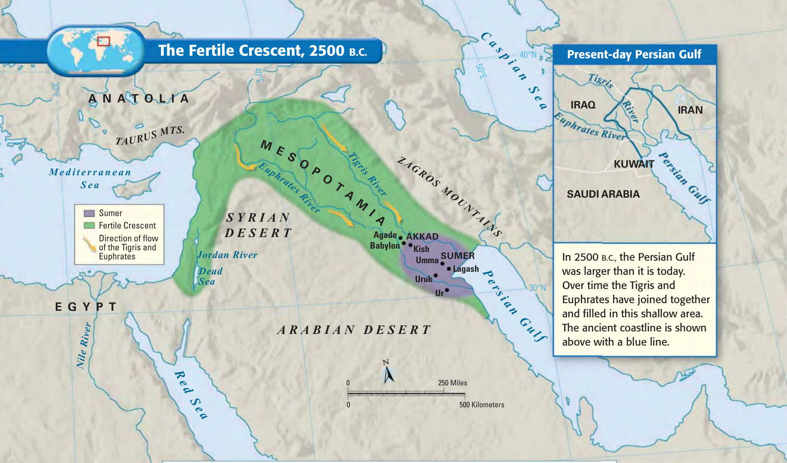
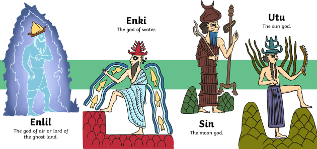
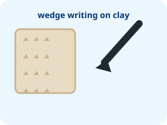
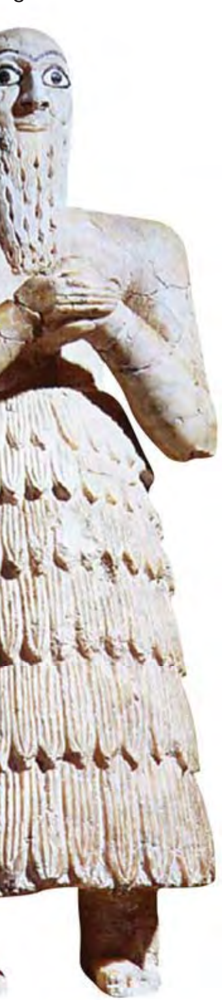
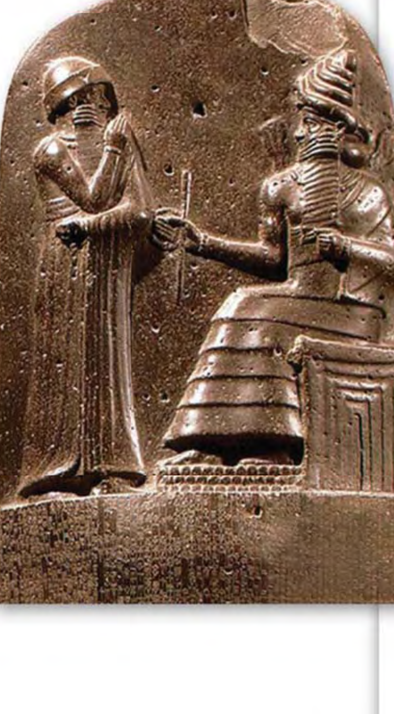

```{python}
import sys; sys.path.append("scripts")
from vocab import load_unit, pick, card_grid
terms = load_unit(1)
```

# Chapter 1 · Mesopotamia 第1章 · 美索不达米亚 {background-color="#003477"}

**Big Question · [核心问题]{.zh}:** Where were the world's first cities, and what did they invent? \
*([世界上最早的城市在哪里？他们发明了什么？]{.zh})*

## Today's Flow · [今日流程]{.zh} (40 min)

:::: {.columns}
::: {.column width="50%"}
### [Stage 1 & 2]{.label}
1. **[Warm-up 导入 (5′)]{.bi}**
   - Welcome & Map observation \
     *([欢迎与地图观察]{.zh})*
2. **[Direct Instruction 讲授 (15′)]{.bi}**
   - Rivers, Sumerians & Hammurabi \
     *([河流、苏美尔人与汉谟拉比]{.zh})*
:::
::: {.column width="50%"}
### [Stage 3 & 4]{.label}
3. **[Learning Activity 学习活动 (15′)]{.bi}**
   - Packet Activities 1.1, 1.2 & 1.3 \
     *([学习单活动 1.1、1.2、1.3]{.zh})*
4. **[Closure 总结 (5′)]{.bi}**
   - What I have learnt & Exit Ticket \
     *([我学到了什么与当堂检测]{.zh})*
:::
::::

::: notes
**Teacher Pacing (40 min total):**
- Stage 1 (5′): Map prompt & pair share to activate prior knowledge.
- Stage 2 (15′): Deliver direct instruction in 3 short chunks (5′ each) interspersed with quick check-ins.
- Stage 3 (15′): Students complete Activities 1.1–1.3 in their learning packets.
- Stage 4 (5′): Choral read closure takeaways and collect packets for formative check.
:::

## Warm-up: Welcome to Mesopotamia! 导入：欢迎来到美索不达米亚！ {background-color="#002b49"}

:::: {.columns}
::: {.column width="50%"}
{fig-alt="Map of Fertile Crescent and Mesopotamia"}

::: {.small-note}
Figure 1 · The  and the two rivers.
:::
:::
::: {.column width="50%"}
Look at the map on your packet:

- [Where is the green land? Why is it green? | 绿色的土地在哪里？它为什么是绿色的？]{.bi}

::: {.callout-note title="Think & Turn and Talk · 思考与同桌讨论" icon=false}
Turn to your partner and finish this sentence: \
👉 **"I think people live near rivers because ________."** \
*([我认为人们住在河边是因为 ________。]{.zh})*
:::


:::
::::

::: notes
**Stage 1 Look-Fors (MYP Criterion A: Vocab in Context):**
- Prompt students to point with their fingers to the green arc on their packet map.
- Sentence starter on board helps ELL students practice expressing cause-and-effect ("because it gives water/food/farming").
:::

## 1. The Land Between Two Rivers 两河之间的土地

:::: {.columns}
::: {.column width="48%"}
{fig-alt="Tigris and Euphrates Rivers flowing to Persian Gulf"}
:::
::: {.column width="52%"}
- **[ | 美索不达米亚]{.bi}**
  - In Greek, it means *"the land between the rivers."* \
    *([在希腊语中，意思是“两河之间的土地”。]{.zh})*

- **[Two Big Rivers | 两条大河]{.bi}**
  1. **Tigris River** *([底格里斯河]{.zh})*
  2. **Euphrates River** *([幼发拉底河]{.zh})*

- **[ | 新月沃地]{.bi}**
  - Green land that is very good for growing food! \
    *([非常适合种植粮食的绿色土地。]{.zh})*
:::
::::

::: notes
Emphasize the geographic shape: a crescent moon curving from the Persian Gulf to the Mediterranean.
Ask: "What two things does a river give farmers?" (Water and rich silt for soil).
:::

## Activity 1.1: Observing the Map 观察地图

:::: {.columns}
::: {.column width="45%"}
{fig-alt="Map of Mesopotamia and Fertile Crescent"}
:::
::: {.column width="55%"}
### [✏️ In Your Packet 在学习单上]{.label}

1. Mesopotamia is the land between two ____________________. \
   *([美索不达米亚是两条____________________之间的土地。]{.zh})*
2. The names of the two rivers are the ____________________ and the ____________________. \
   *([这两条河的名字是____________________和____________________。]{.zh})*
3. The green land that is good for farming is called the ____________________ Crescent. \
   *([适合种地的绿色土地被称为____________________沃地。]{.zh})*


:::
::::

::: notes
Circulate to check spelling of Tigris, Euphrates, rivers, and Fertile.
Answer key: 1. rivers (河流); 2. Tigris, Euphrates (底格里斯河, 幼发拉底河); 3. Fertile (新月).
:::

## 2. The Sumerians 苏美尔人

:::: {.columns}
::: {.column width="50%"}
{fig-alt="Mesopotamian Ziggurat and Sumerian City"}

::: {.small-note}
A Sumerian city with tall walls and a  temple.
:::
:::
::: {.column width="50%"}
The first people to build cities here were the **** *([苏美尔人]{.zh})*.

### [Key Inventions 重要发明]{.label}
1. **The Wheel** *([车轮]{.zh})* — for heavy carts and farming wagons.
2. **Writing** *([文字]{.zh})* — to keep count of grain, taxes, and trade!

> [The Sumerians did not have paper or modern machines. They built great cities using mud bricks and clever ideas! | 苏美尔人没有纸和现代机器，他们用泥砖和聪明智慧建造了大城市！]{.bi}
:::
::::

::: notes
Highlight the connection: food surplus -> people don't all need to farm -> craftspeople invent the wheel and scribes invent writing!
:::

## The First Writing: Cuneiform 最早的文字：楔形文字

:::: {.columns}
::: {.column width="45%"}
{width="180px" fig-alt="Cuneiform symbol"}
{width="220px" fig-alt="Sumerian statue"}

::: {.small-note}
Sumerian scribes carved wedge marks on clay.
:::
:::
::: {.column width="55%"}
Their writing system is called **** *([楔形文字]{.zh})*.

- **[No Paper | 没有纸张]{.bi}:** They wrote on tablets made of **soft clay** *([软泥板]{.zh})*.
- **[Reed Stylus | 芦苇尖笔]{.bi}:** They pressed a sharpened reed stick into the clay.
- **[Wedge Shapes | 楔子形状]{.bi}:** Marks look like little triangles and lines ($\nabla \rhd$).
- **[Permanent Records | 永久保存]{.bi}:** When the clay baked in the hot sun, it turned hard as stone!
:::
::::

::: notes
Demonstrate pressing the edge of a ruler or pencil tip into playdough or an eraser to show how a wedge mark is made.
Ask: "Why was clay better than paper in a dry, river environment?" (Plenty of mud/clay along riverbanks, lasts thousands of years).
:::

## Activity 1.2: Match the Words 连线题

Draw lines on your packet to connect each word to its Chinese meaning: \
*([在学习单上画线，将每个英文单词连接到对应的中文含义：]{.zh})*

:::: {.columns}
::: {.column width="48%"}
### [English Terms 英文词汇]{.label}
- **1. Sumerians**
- **2. Cuneiform**
- **3. Wheel**
:::
::: {.column width="48%"}
### [Chinese Meaning 中文含义]{.label}
- **A.** [楔形文字 (The first writing on soft clay)]{.zh}
- **B.** [车轮 (A circle that helps carts move)]{.zh}
- **C.** [苏美尔人 (The first people to build cities)]{.zh}
:::
::::



::: notes
Activity 1.2 is a quick diagnostic check for Criterion A (vocabulary recognition).
Answers: 1 -> C, 2 -> A, 3 -> B.
:::

## 3. King Hammurabi & His Laws 汉谟拉比国王与他的法律

:::: {.columns}
::: {.column width="40%"}
{fig-alt="Stele of Hammurabi"}

::: {.small-note}
The Stele of Hammurabi: a 2-meter tall black stone pillar.
:::
:::
::: {.column width="60%"}
- **[King Hammurabi | 汉谟拉比国王]{.bi}**
  - Ruled the ancient kingdom of **Babylon** *([古巴比伦]{.zh})*.

- **[The First Written Code | 第一套成文法典]{.bi}**
  - He carved **282 laws** onto tall black stone pillars for all to see.
  - Known as the **** *([《汉谟拉比法典》]{.zh})*.

- **[Why Carve on Stone? | 为什么刻在石头上？]{.bi}**
  - So rules could not be easily changed or forgotten!
:::
::::

::: notes
Point out the top carving on the stele: King Hammurabi receiving the laws directly from Shamash, the sun god and god of justice.
This showed the people that the laws had religious authority.
:::

## "An Eye for an Eye" “以眼还眼”

The most famous rule from Hammurabi's Code: \
*([《汉谟拉比法典》中最著名的一条规则：]{.zh})*

> ### *"An eye for an eye, a tooth for a tooth."*
> ### *“以眼还眼，以牙还牙。”*

:::: {.columns}
::: {.column width="50%"}
### [What it Means 含义]{.label}
- If you hurt someone, **the exact same punishment** happens to you. \
  *([如果你伤害了别人，相同的伤害将作为惩罚施加于你。]{.zh})*
:::
::: {.column width="50%"}
### [Social Rank Rule 阶层差异]{.label}
- In Babylon, punishments also depended on whether you were a noble, a commoner, or an enslaved person! \
  *([在古巴比伦，惩罚还取决于人的社会等级！]{.zh})*
:::
::::

::: notes
Criterion D prompt preparation: Discuss whether this was fair.
In ancient times, this stopped unlimited revenge (blood feuds) because punishment was limited to the injury done. But it also favored rich nobles over commoners.
:::

## Activity 1.3: Think and Think! 思考与思考！

Read the law again: *"An eye for an eye."* \
*([再读一遍这条法律：“以眼还眼，以牙还牙。”]{.zh})*

### [Is this law fair today? 在今天，这条法律公平吗？]{.label}

:::: {.columns}
::: {.column width="50%"}
1. **Circle ONE on your packet:**
   - **YES** (公平)  or  **NO** (不公平)
2. **Write ONE reason using this sentence frame:**
   - 👉 *"I think it is ________ because ________."* \
     *([我认为它________，因为________。]{.zh})*
:::
::: {.column width="50%"}
::: {.callout-tip title="Word Bank for Your Reason · 常用理由词汇" icon=false}
- **fair** (公平的) · **unfair** (不公平的)
- **hurts people** (伤害他人) · **protects victims** (保护受害者)
- **violence** (暴力) · **teaches a lesson** (吸取教训)
:::


:::
::::

::: notes
**Year 1 Criterion D: Thinking Critically (Giving an opinion with reasons):**
- Level 1–2: Student circles YES or NO with minimal or unclear reason.
- Level 3–4: Student states adequate reason using the sentence starter (e.g., "I think it is unfair because modern courts put people in jail instead of hurting them").
- Level 5–6: Student gives substantial reason distinguishing ancient context vs modern justice.
:::

## What I Have Learnt 我学到了什么 {background-color="#003477"}

Let's read the 3 key ideas aloud together! \
*([让我们一起大声朗读三个核心知识点！]{.zh})*

::: {.incremental}
- ✔️ **Mesopotamia** is the fertile land between the **Tigris** and **Euphrates** rivers. \
  *([美索不达米亚是底格里斯河和幼发拉底河之间的肥沃土地。]{.zh})*

- ✔️ The **Sumerians** built the first cities and invented the **wheel** and **cuneiform** writing. \
  *([苏美尔人建立了最早的城市，并发明了车轮和楔形文字。]{.zh})*

- ✔️ King **Hammurabi** carved the world's first written set of laws (*"an eye for an eye"*). \
  *([汉谟拉比国王刻下了世界上第一套成文法律（“以眼还眼”）。]{.zh})*
:::

::: {.callout-important title="Hand in your packet! · 请上交学习单！" icon=false}
**Check your name and table number on your packet before handing it in.**
:::

::: notes
Wrap up the 40-minute lesson. Collect all student packets to evaluate Criterion A (vocab/map) and Criterion D (opinion statement).
:::
